# 6. Exercici extra: Màquina Meow (Starting Point)

Resolució completa de la màquina **Meow** (nivell *Very Easy*, sistema operatiu *Linux*) dins de la plataforma **Hack The Box Starting Point**.

## Connexió i qüestionari inicial (Tasks 1 - 7)

Abans d'obtenir la *flag* final, es responen les preguntes teòriques i de reconeixement de la màquina:

| Task | Pregunta | Resposta |
| :--- | :--- | :--- |
| **Task 1** | What does VM stand for? | `Virtual Machine` |
| **Task 2** | What tool do we use to interact with the operating system via command line? | `terminal` |
| **Task 3** | What service do we use to form our VPN connection into HTB labs? | `openvpn` |
| **Task 4** | What tool do we use to test our connection to the target with an ICMP echo request? | `ping` |
| **Task 5** | What is the name of the most common tool for finding open ports on a target? | `nmap` |
| **Task 6** | What service do we identify on port 23/tcp during our scans? | `telnet` |
| **Task 7** | What username is able to log into the target over telnet with a blank password? | `root` |

## Procediment d'explotació pas a pas

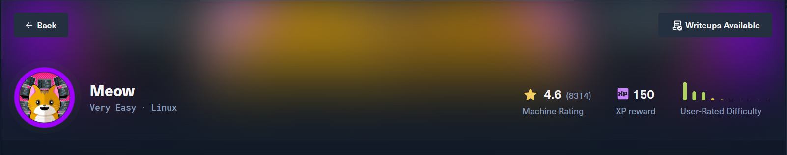

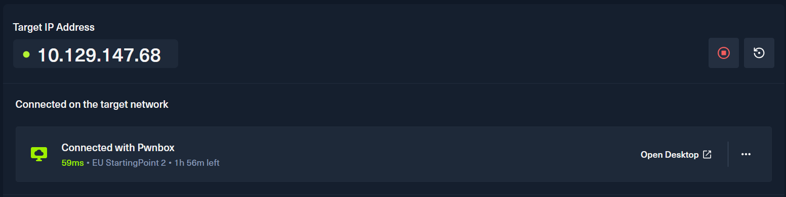

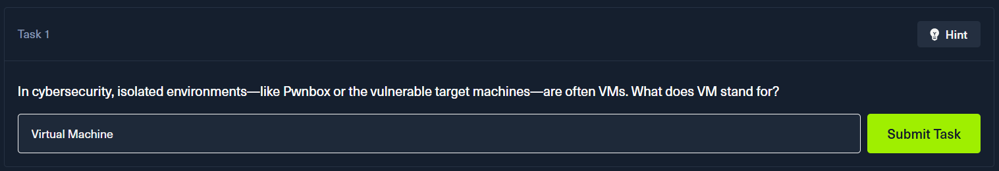

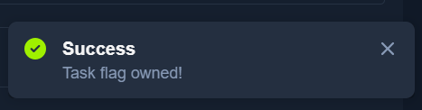

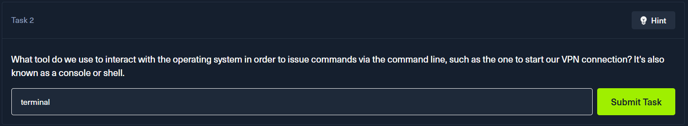

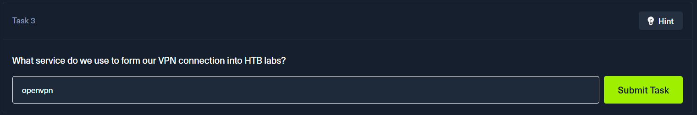

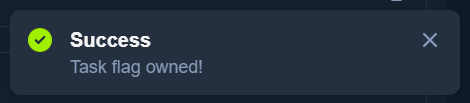

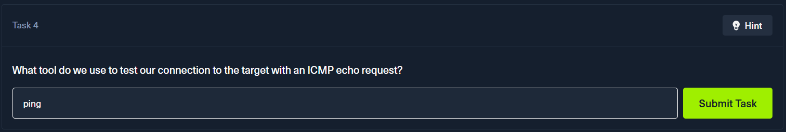

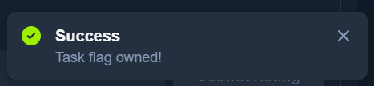

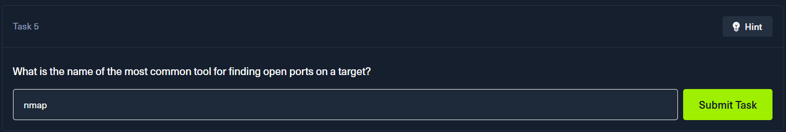

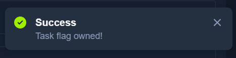

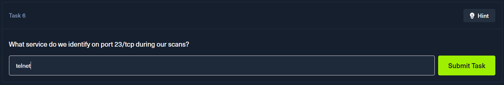

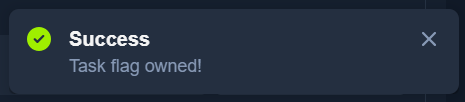

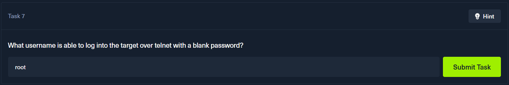

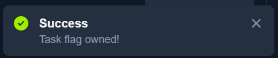

Obrim la màquina amb un terminal:

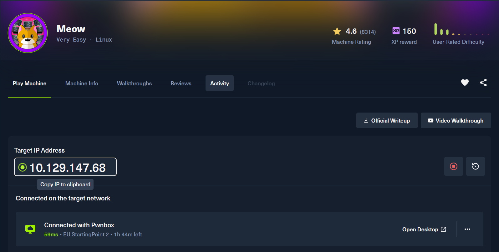

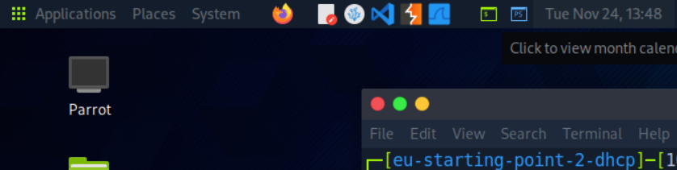

i escrivim la comanda per connectar-nos per telnet:

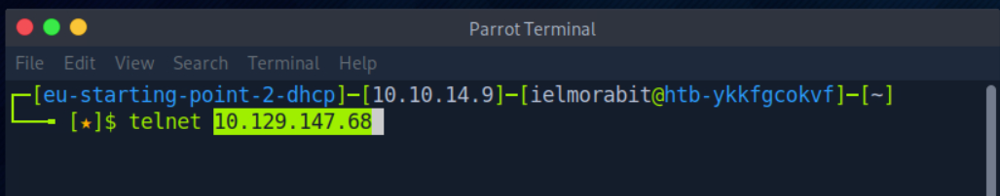

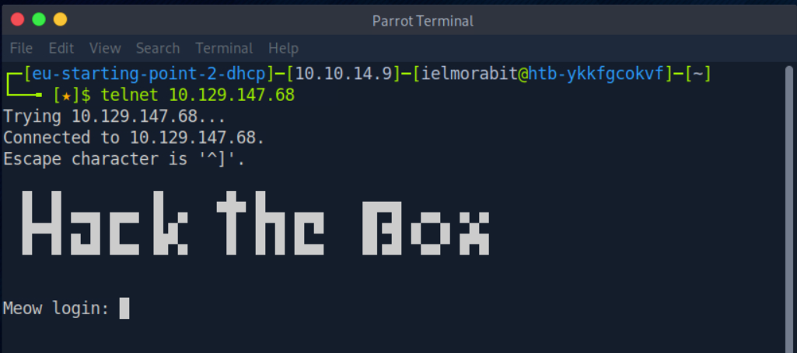

una vegada dins la maquina victima a través de telnet, ens loguejem amb root:

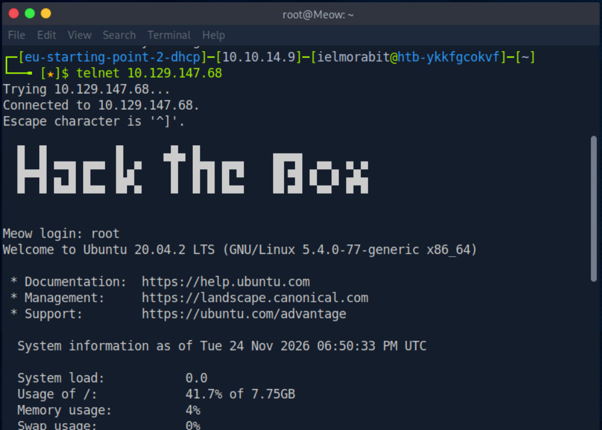

I automàticament ens otorga accès. Ara llistem els directoris en busca de l’arxiu “flags”:

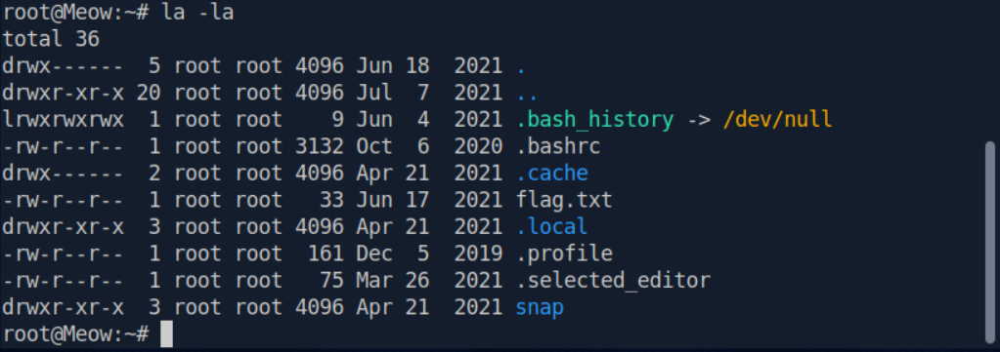

Amb la comanda cat el podrem llegir:

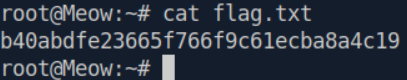

Copiem el text i el peguem al HTB:

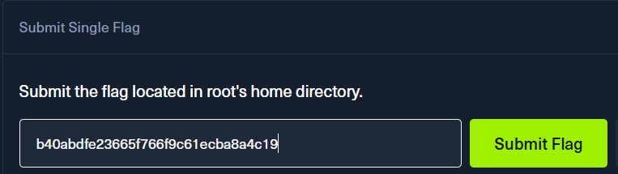

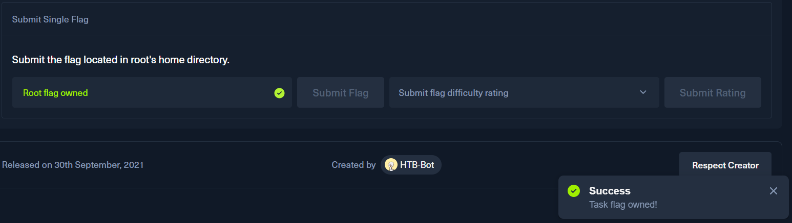

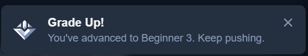

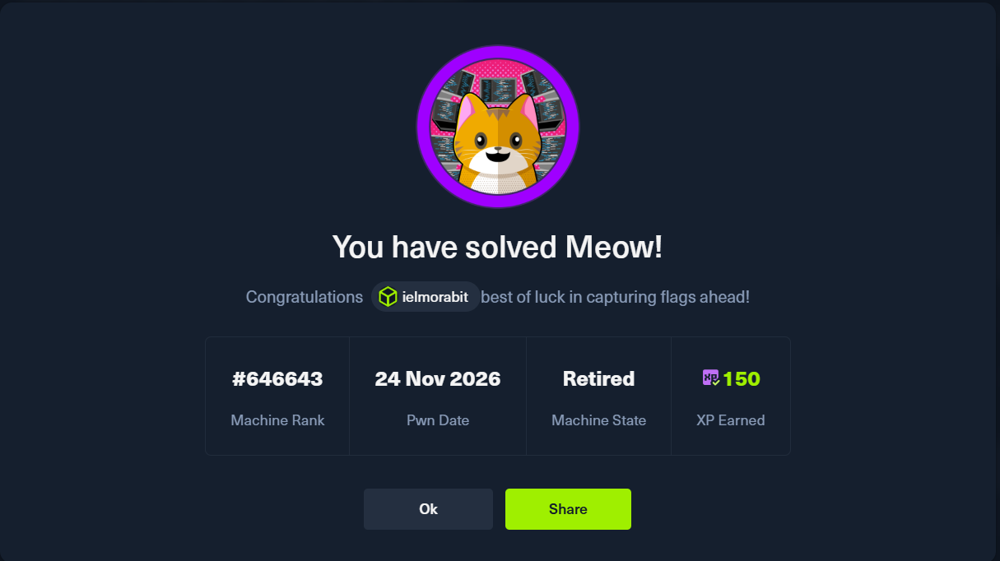

## Resultat final

* **Flag obtinguda:** `b40abdfe23665f766f9c61ecba8a4c19`
* **Estat:** Màquina completada (*Meow Pwned*) i perfil actualitzat a [Hack The Box](https://profile.hackthebox.com/profile/01a20f02-f682-7086-a4be-b0f8c4ed27cf?utm_medium=copy_url).
