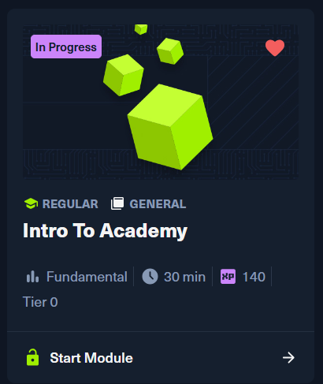
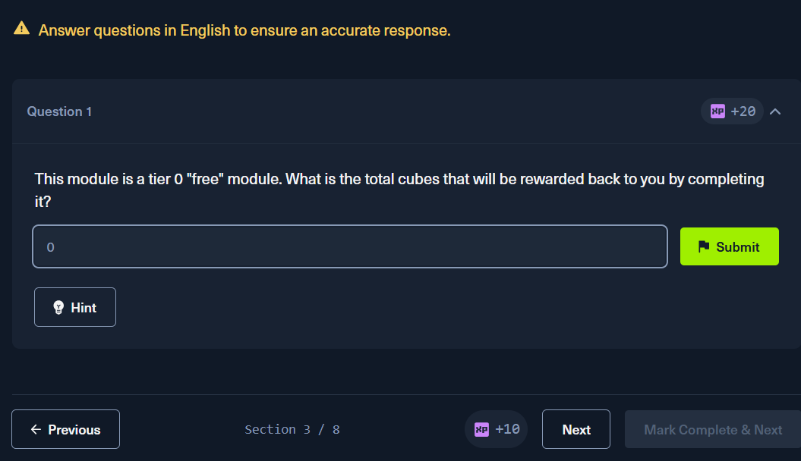
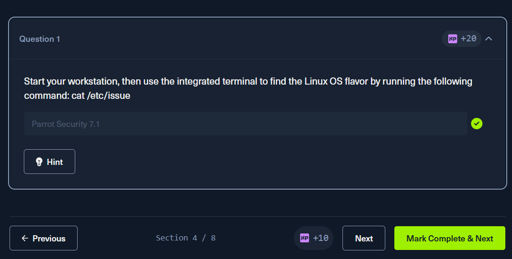
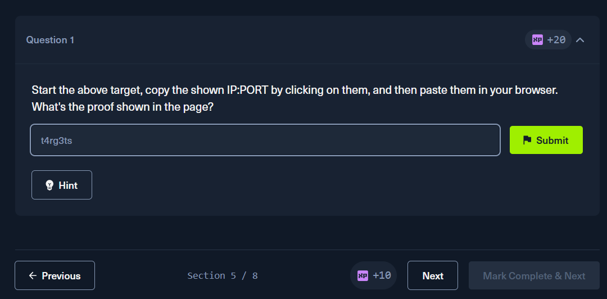

# 1. Intro to Academy

Aquest mòdul introductori presenta l'ecosistema de **Hack The Box Academy**, el sistema de punts/cubs, l'ús de l'entorn integrat **Pwnbox** (basat en Parrot Security) i la connexió a màquines objectiu (*targets*).

## Resum d'activitats realitzades

* **Sistema de recompenses (Tier 0):** Verificació del retorn de cubs en completar mòduls gratuïts (`0` cubs).
* **Entorn Pwnbox:** Inici de l'estació de treball i identificació del sistema operatiu mitjançant `cat /etc/issue` (`Parrot Security 7.1`).
* **Connexió a Targets:** Desplegament d'una instància objectiu, accés via navegador a `IP:PORT` i obtenció de la prova (`t4rg3ts`).

## Evidències i captures de pantalla

