# 2. Getting Started

En aquest mòdul s'aborden els fonaments pràctics d'una auditoria de seguretat: reconeixement de serveis amb `nmap`, captura de *banners*, enumeració web, cerca d'exploits públics, moviment lateral i escalada de privilegis en sistemes Linux.

## Resum d'activitats i respostes clau

* **Banner Grabbing:** Obtenció de la capçalera SSH (`SSH-2.0-OpenSSH_8.2p1 Ubuntu-4ubuntu0.1`).
* **Escaneig amb Nmap:** Identificació de serveis i versions en ports no estàndard (Apache Tomcat al port `8080`, Telnet al port `2323` i Apache `2.4.18`).
* **Enumeració SMB i Web:** Connexió a recursos compartits SMB com a usuari `bob` i descoberta de directoris ocults (`HTB{w3b_3num3r4710n_r3v34l5_53cr375}`).
* **Explotació i Escalada de Privilegis:** Accés inicial amb exploits públics (`HTB{my_f1r57_h4ck}`), moviment lateral via SSH de `user1` a `user2` (`HTB{l473r4l_m0v3m3n7_70_4n07h3r_u53r}`) i escalada a `root` (`HTB{pr1v1l363_35c4l4710n_2_r007}` i flags finals).

## Evidències i captures de pantalla

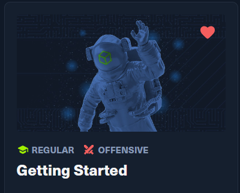

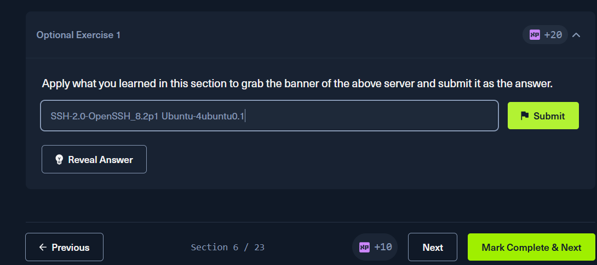

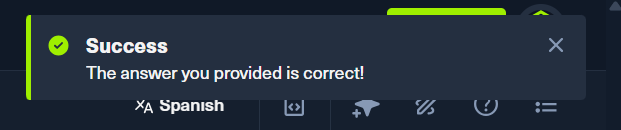

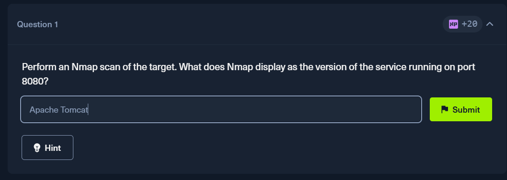

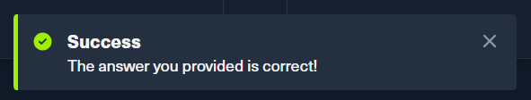

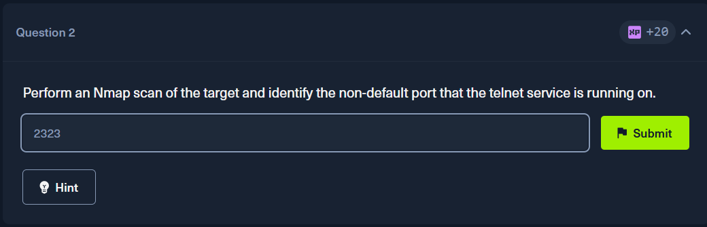

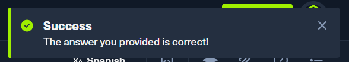

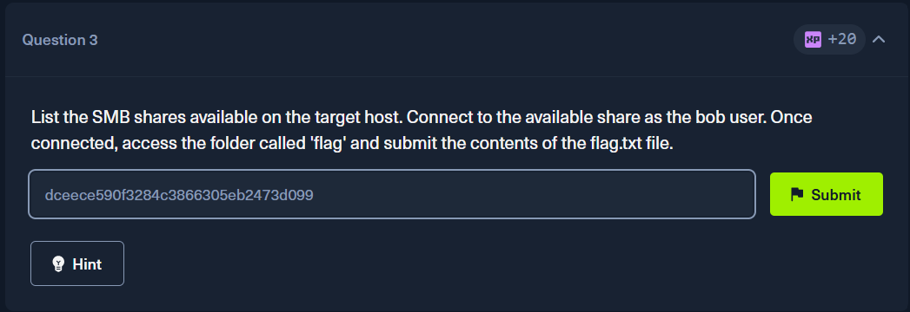

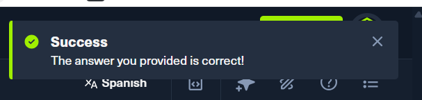

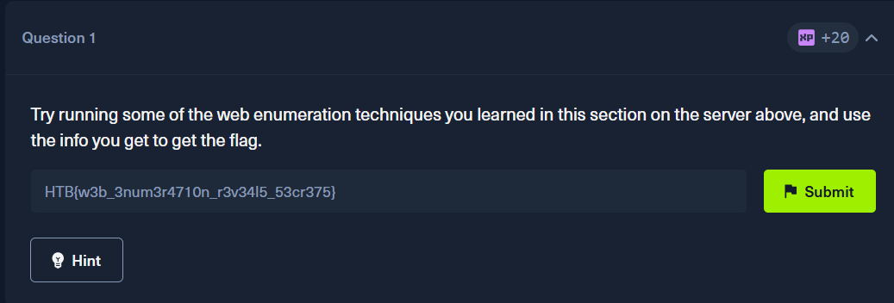

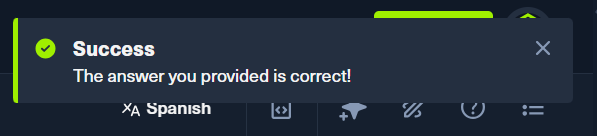

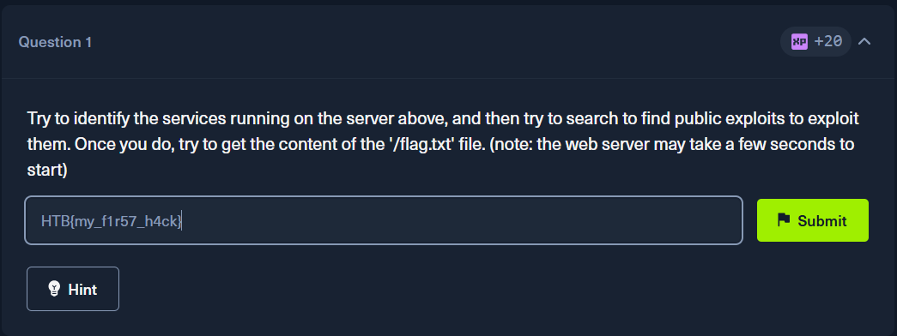

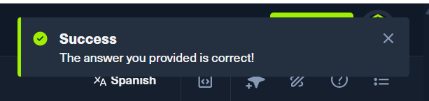

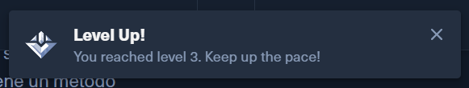

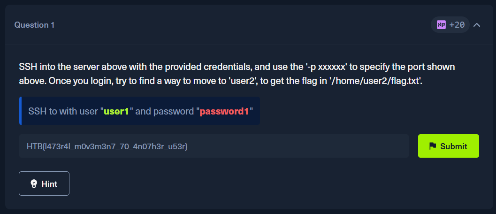

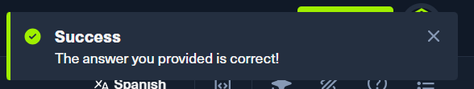

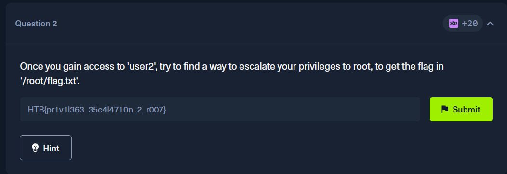

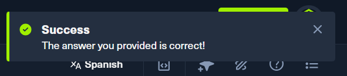

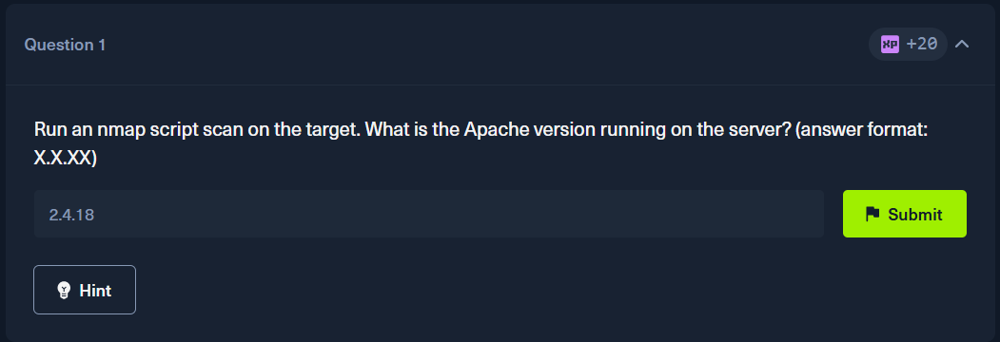

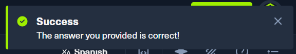

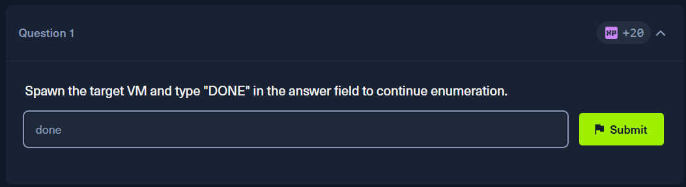

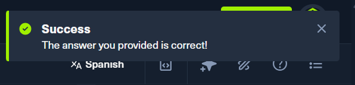

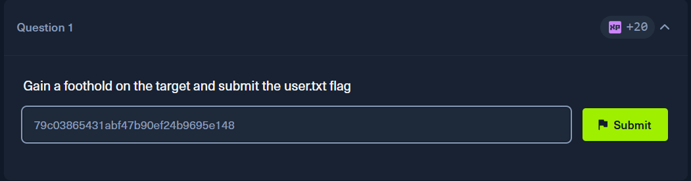

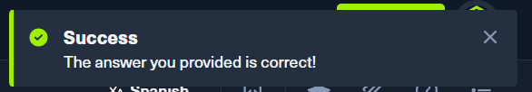

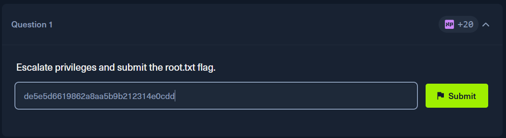

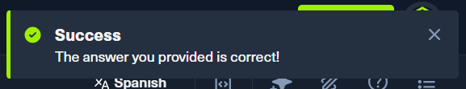

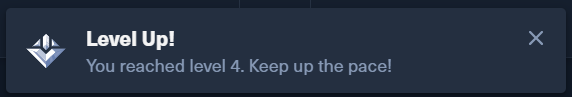

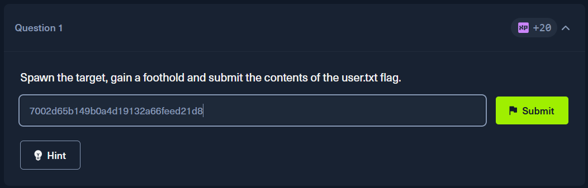

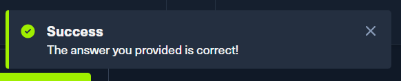

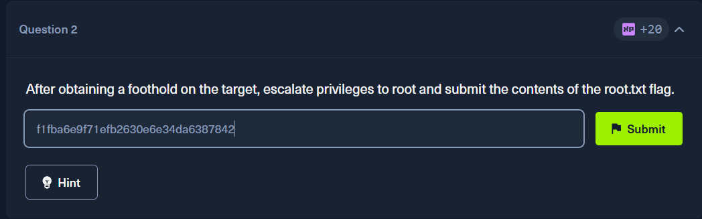

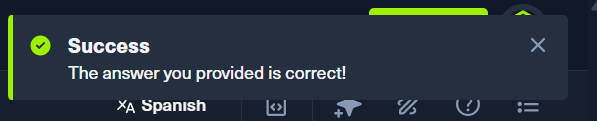

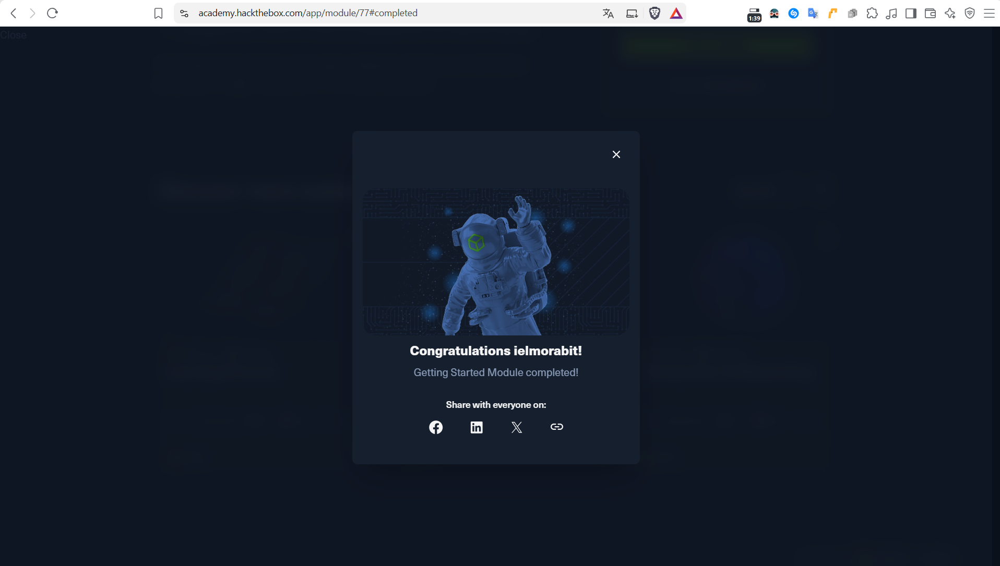
