# 3. Introduction to Web Applications

Aquest mòdul explica l'arquitectura client-servidor de les aplicacions web modernes, les tecnologies *front-end* (HTML, CSS, JavaScript), el funcionament detallat de les peticions i codis d'estat HTTP, i la identificació de vulnerabilitats comunes.

## Resum d'activitats i respostes clau

* **Front-end (HTML i CSS):** Etiqueta HTML per a imatges (``) i propietat CSS d'alineació (`text-align: left;`).
* **Exposició d'informació sensible:** Inspecció del codi font d'un formulari d'inici de sessió per detectar credencials exposades (`HiddenInPlainSight`).
* **Cross-Site Scripting (XSS):** Prova d'injecció HTML amb `<a href="http://www.hackthebox.com">Click Me</a>` i extracció del valor de la galeta de sessió (`XSSisFun`).
* **HTTP, Bases de Dades i CVEs:** Significat del codi HTTP `201` (`Created`), tipus de base de dades de Google Firebase (`NoSQL`), consulta amb paràmetres GET (`/index.php?id=0` -> `superadmin`) i anàlisi de vulnerabilitats públiques (`CVE-2014-6271` *Command Injection* i `CVE-2017-0144` amb puntuació CVSS v2.0 `9.3`).

## Evidències i captures de pantalla

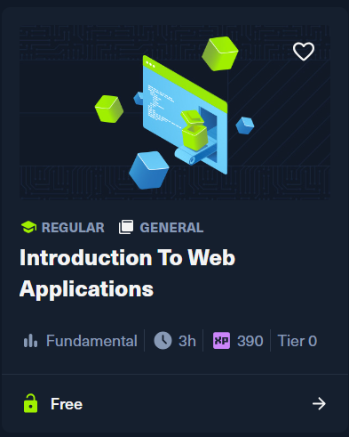

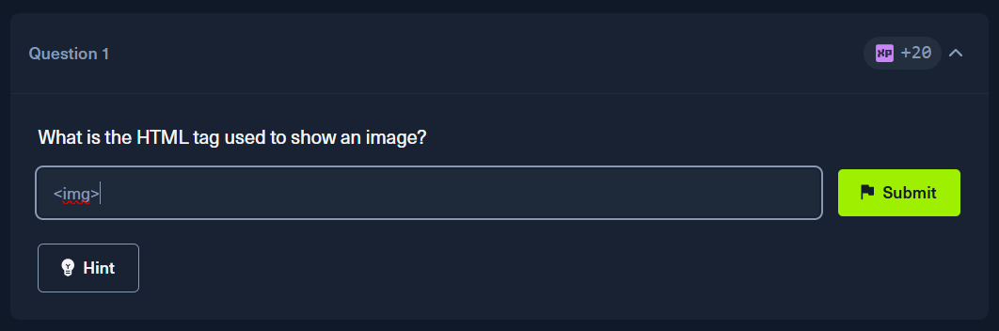

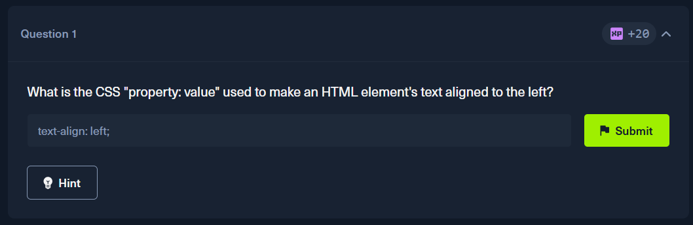

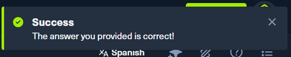

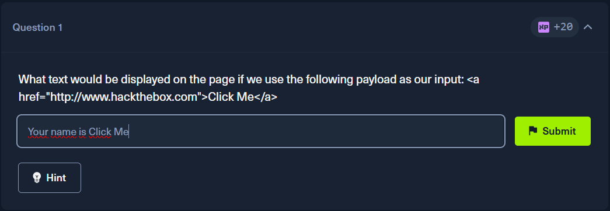

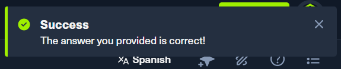

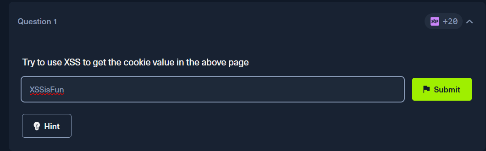

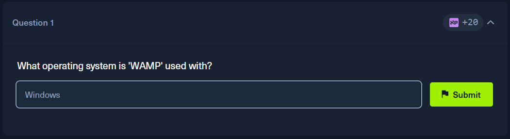

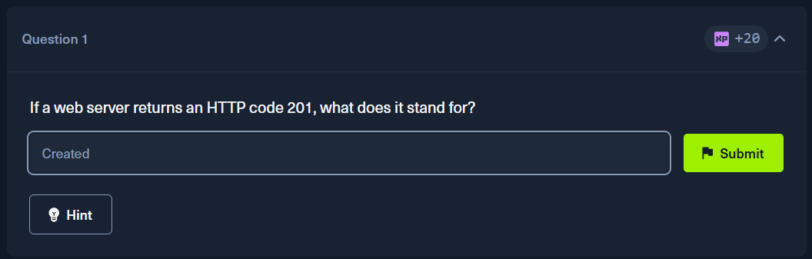

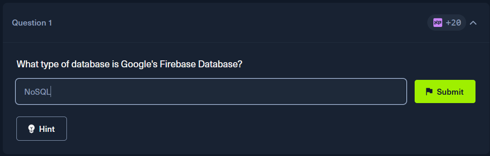

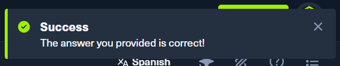

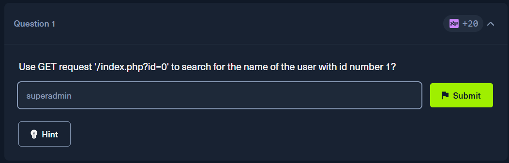

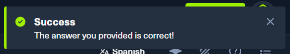

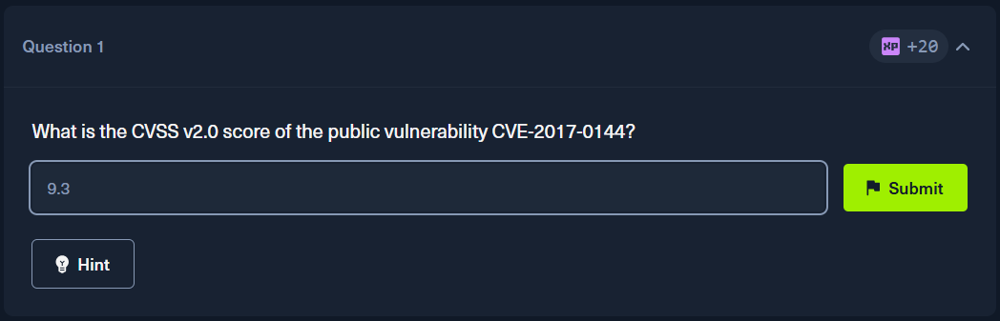

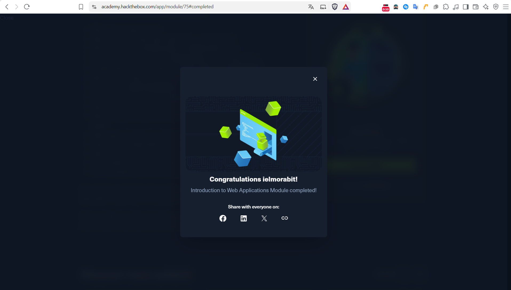
