# 4. Attacking Web Applications with Ffuf

Aquest mòdul aprofundeix en les tècniques de *fuzzing* web automatitzat amb l'eina **ffuf** (*Fuzz Faster U Fool*) per descobrir recursos ocults, directoris, extensions de fitxer, subdominis, *Virtual Hosts* (VHosts) i paràmetres GET/POST.

## Resum d'activitats i respostes clau

* **Fuzzing de directoris i pàgines:** Identificació dels directoris `/blog` i `/forum`, i enumeració de pàgines internes (`HTB{bru73_f0r_c0mm0n_p455w0rd5}` i `HTB{fuzz1n6_7h3_w3b!}`).
* **Fuzzing de subdominis i VHosts:** Descoberta de `customer.inlanefreight.com` i dels subdominis/VHosts `test`, `archive` i `faculty` sobre `*.academy.htb`.
* **Fuzzing d'extensions i paràmetres:** Detecció de les extensions `.php`, `.php7` i `.phps`, localització de `http://faculty.academy.htb:PORT/courses/linux-security.php7`, identificació dels paràmetres `user` i `username`, i obtenció de les flags mitjançant peticions GET i POST (`HTB{p4r4m373r_fuzz1n6_15_k3y!}` i `HTB{w3b_fuzz1n6_m4573r}`).

## Evidències i captures de pantalla

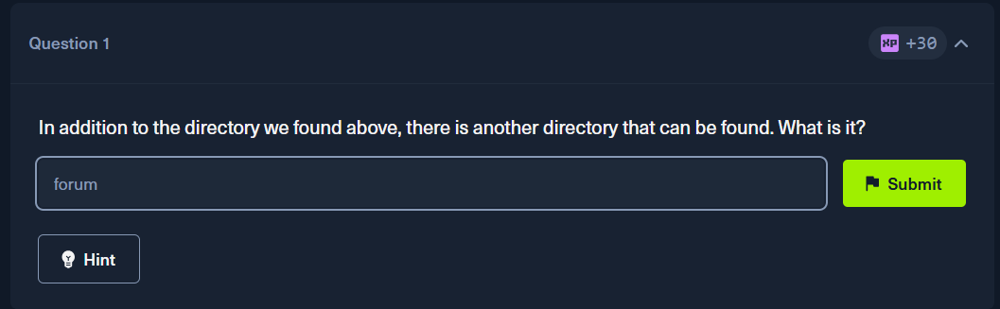

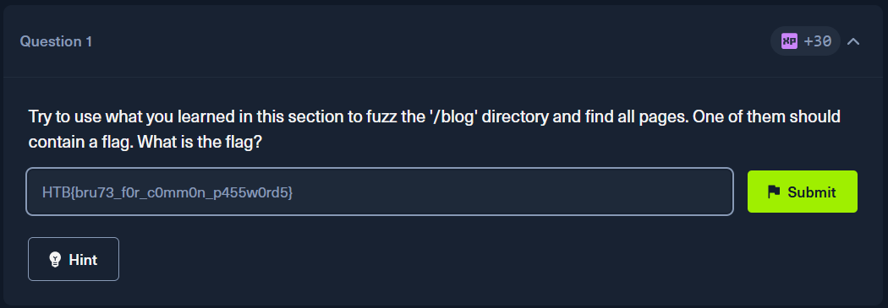

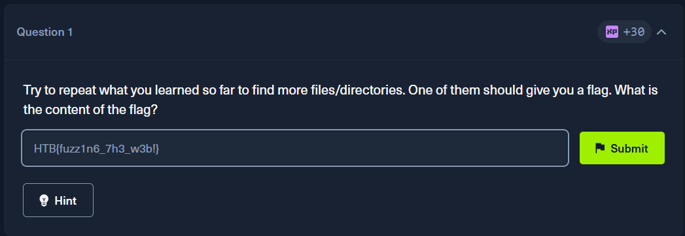

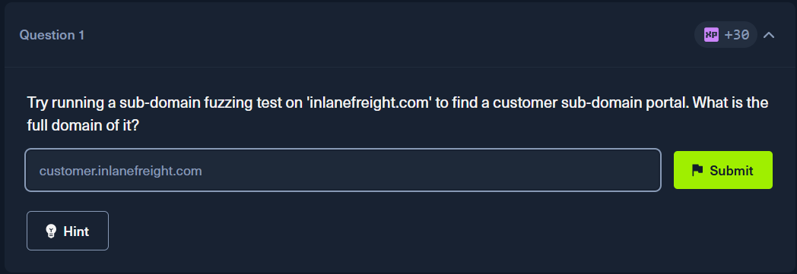

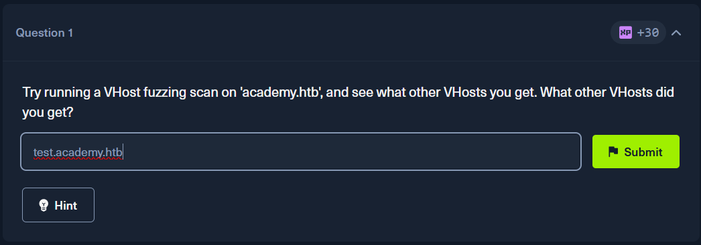

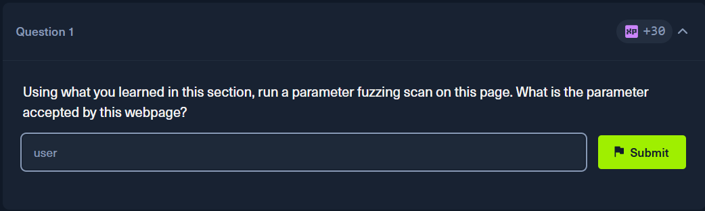

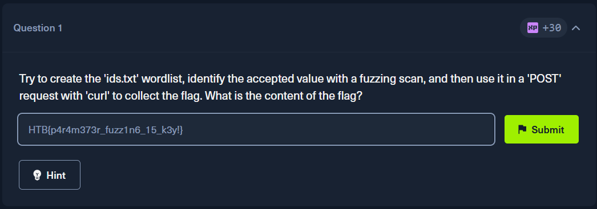

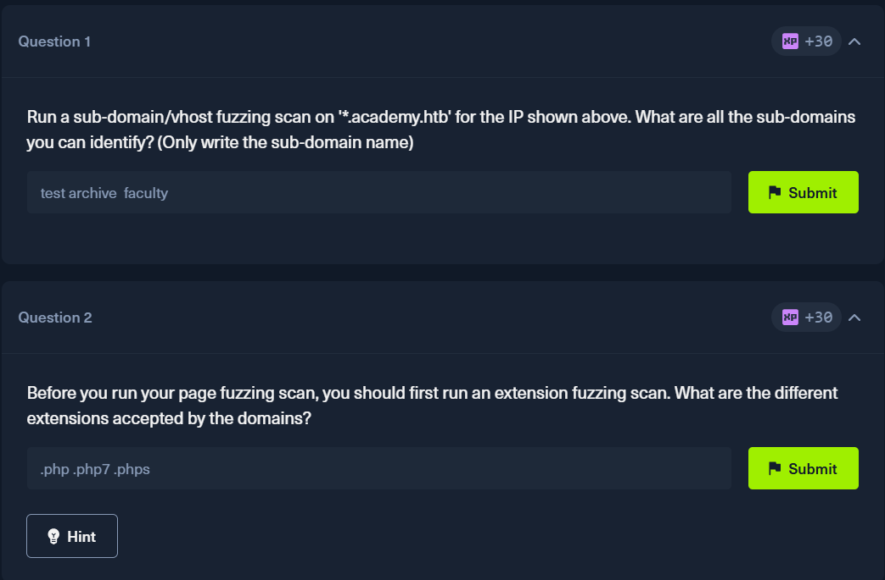

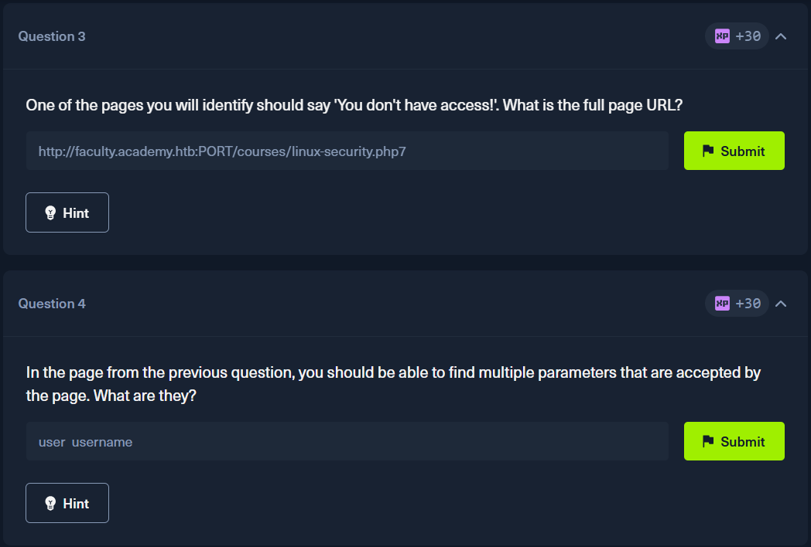

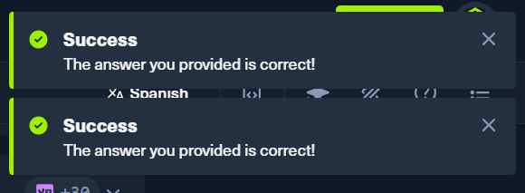

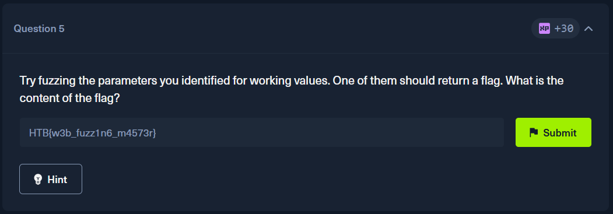

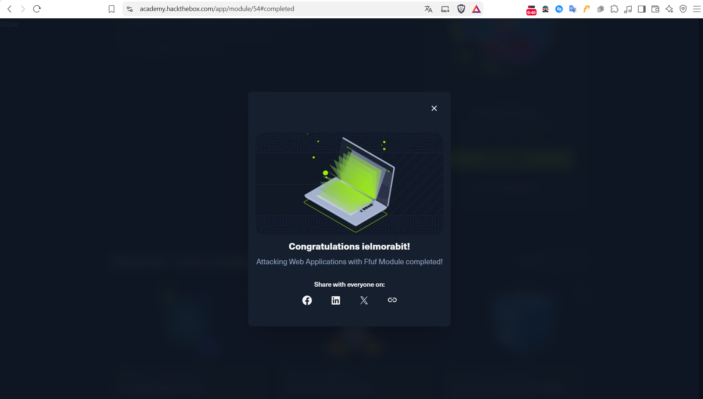
