# 5. SQL Injection Fundamentals

Aquest mòdul cobreix l'ús de bases de dades relacionals (MySQL) i l'explotació de vulnerabilitats d'**injecció SQL (SQLi)**: enumeració d'esquemes i taules, evasió d'autenticació, atacs basats en `UNION`, lectura de fitxers del servidor i execució remota de codi (RCE).

## Resum d'activitats i respostes clau

* **Consultes SQL bàsiques:** Connexió al client MySQL, llistat de bases de dades (`employees`), filtratge per departament (`d005`) i condicions `AND`/`OR` (`Mitchem`, `654` i `663` registres).
* **Authentication Bypass:** Accés com a usuari `tom` (`202a1d1a8b195d5e9a57e434cc16000c`) i com a l'usuari amb `id = 5` (`cdad9ecdf6f14b45ff5c4de32909caec`).
* **UNION SQL Injection:** Extracció de l'usuari de la base de dades (`root@localhost`), obtenció del hash de contrasenya de `newuser` (`9da2c9bcdf39d8610954e0e11ea8f45f`) i del hash Argon2i de `admin`.
* **Lectura de fitxers i RCE:** Lectura de fitxers PHP inclosos (`dB_pAssw0rd_iS_flag!`), obtenció d'una *webshell* (`d2b5b27ae688b6a0f1d21b7d3a0798cd`), identificació de la ruta arrel (`/var/www/chattr-prod`) i lectura de `/flag_XXXXXX.txt` (`061b1aeb94dec6bf5d9c27032b3c1d8d`).

## Evidències i captures de pantalla

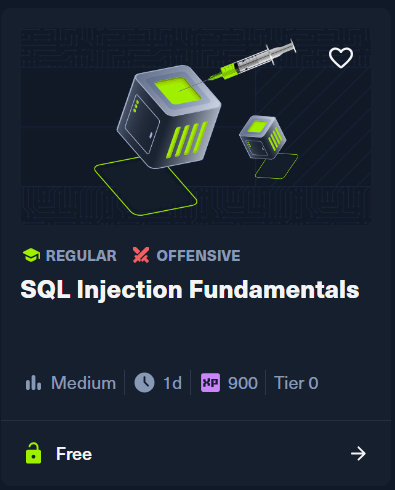

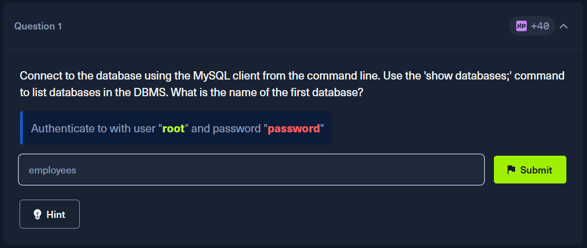

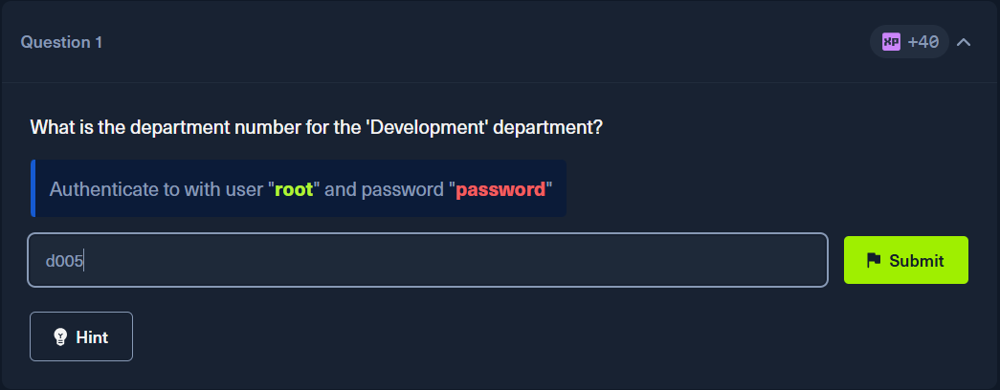

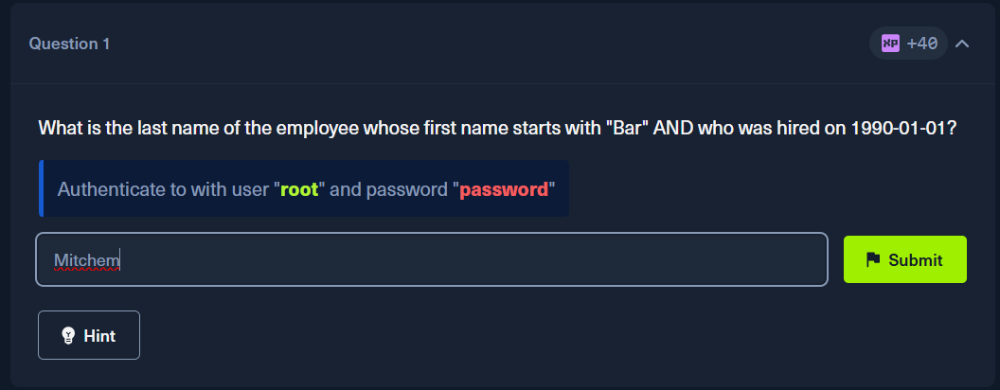

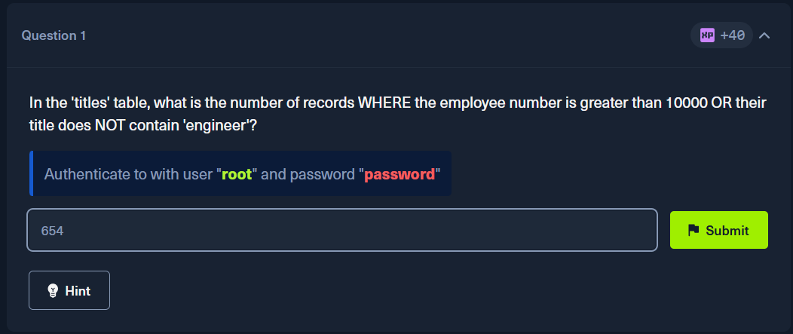

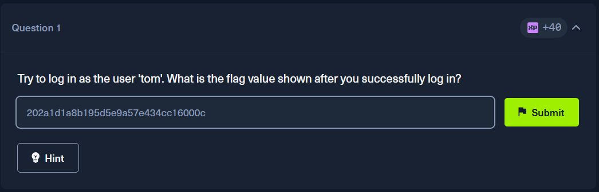

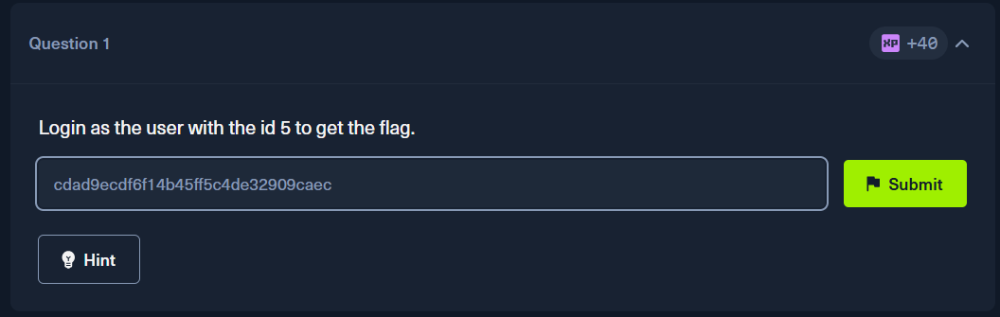

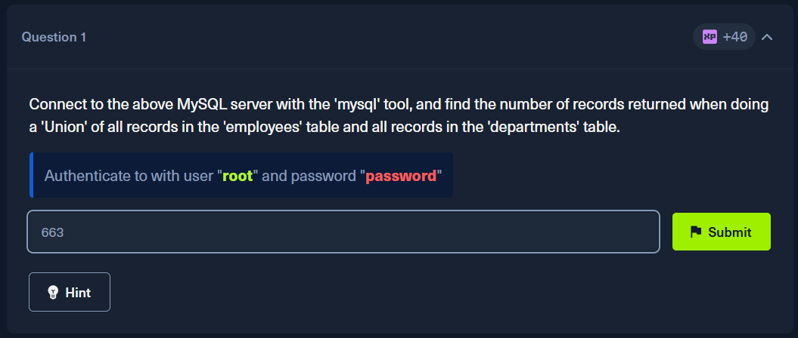

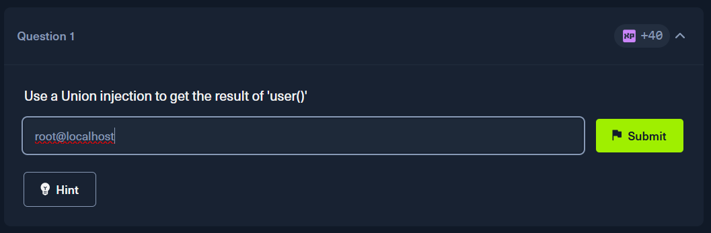

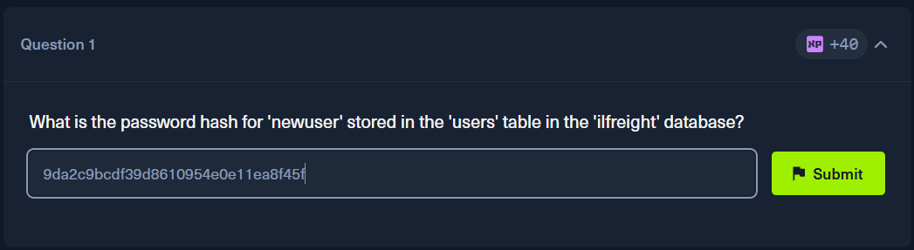

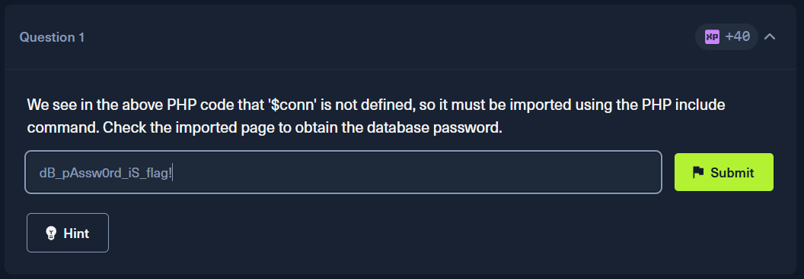

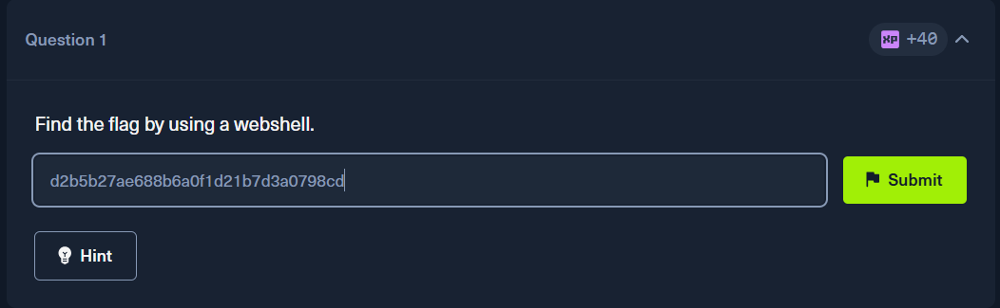

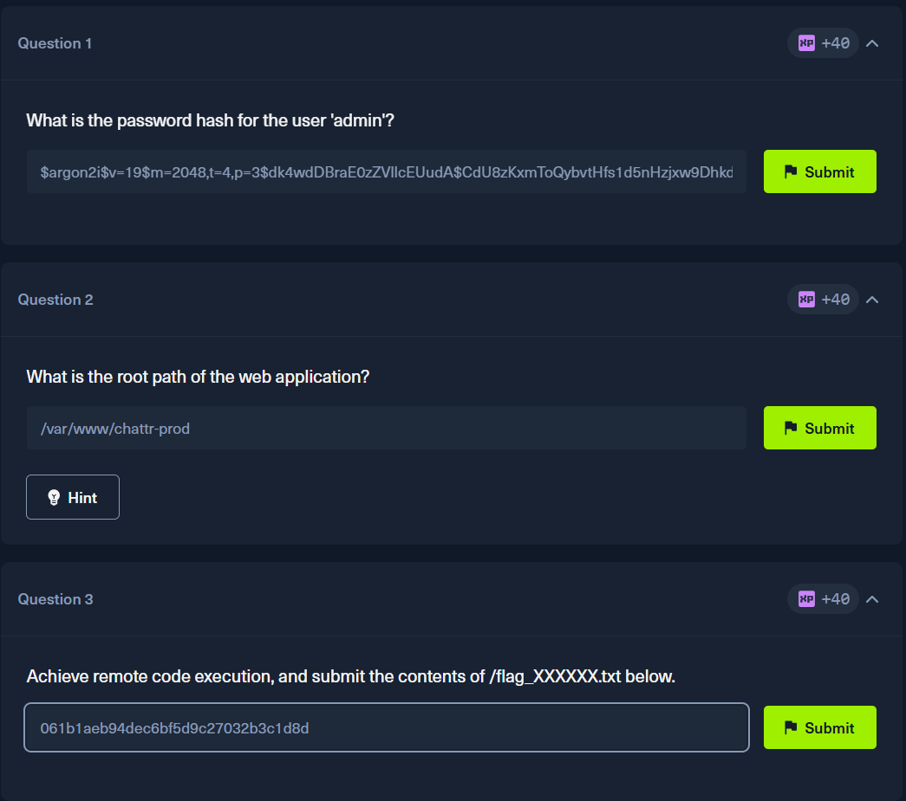

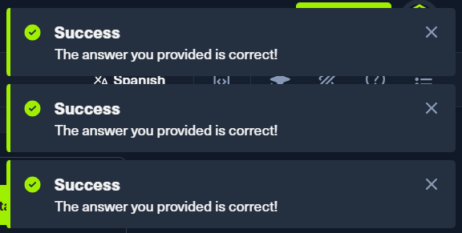

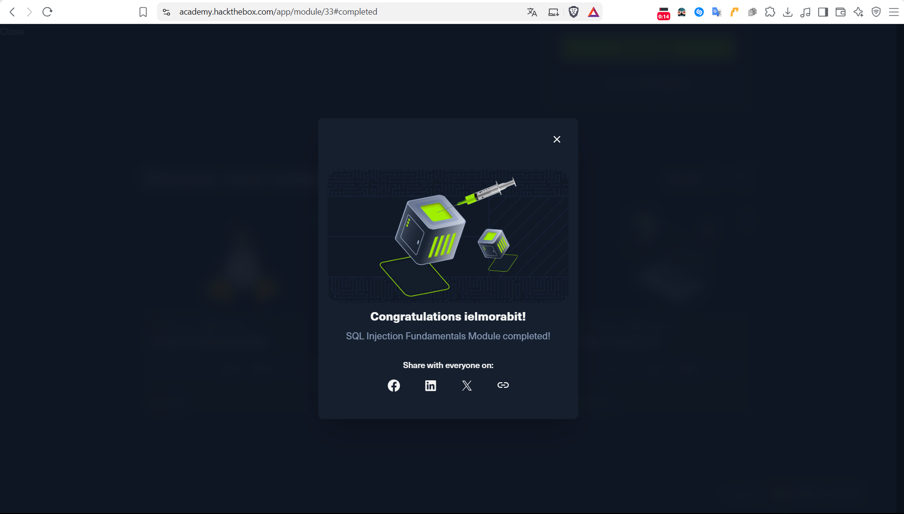
